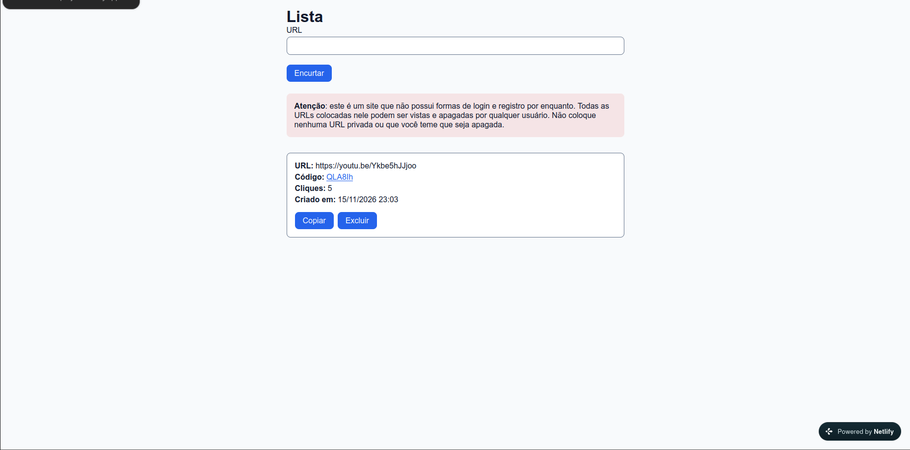

# Encurtador de Links

Encurta URLs e mostra quantos cliques cada link recebeu, com o total e a contagem por dia, além da data de criação.

Projeto de estudo: usei o Claude Code como tutor para aprender Angular, TypeScript e Quarkus. Eu escrevia o código, e ele revisava, apontava boas práticas e riscos de segurança e me fazia chegar às soluções sozinho, em vez de entregá-las prontas.

**Acesse:** https://linksshortenerproject.netlify.app



## Avisos importantes

- **Primeiro acesso lento:** o backend está no plano gratuito do Render, que desliga o servidor depois de 15 minutos sem uso. O primeiro acesso depois disso pode levar cerca de 1 minuto; os seguintes são normais.
- **Links curtos nem tão curtos:** o link gerado usa o endereço gratuito do Render (`encurtadordelinks-mxjb.onrender.com/abc123`), então pode sair maior que a URL original. Para resolver isso, é preciso um domínio curto próprio.
- **Links públicos:** o site não tem login, então qualquer pessoa pode ver e excluir os links criados. Não encurte URLs privadas ou com dados sensíveis (ex.: link de documento compartilhado ou de formulário com dados pessoais).

## Funcionalidades

- Encurtar uma URL e copiar o link curto com um clique.
- Ver a lista de links criados, com o total de cliques e a data de criação de cada um.
- Ver os detalhes de um link, com a contagem de cliques por dia.
- Excluir links.
- Aviso quando a URL digitada é inválida.
- Layout que funciona no celular e no computador.

## Tecnologias

- **Backend:** Java 25, Quarkus 3.40, Hibernate ORM com Panache, Hibernate Validator.
- **Frontend:** Angular 22, TypeScript 6, CSS puro.
- **Banco de dados:** PostgreSQL 18, Flyway.
- **Deploy:** backend em container Docker no Render, frontend no Netlify e banco no Neon.

## Limitações

- **Sem login:** qualquer pessoa vê e exclui qualquer link (ver Avisos importantes).
- **Cliques agrupados por dia em UTC:** o servidor separa os dias pelo horário UTC. Um clique às 22h de Manaus (UTC−4) conta no dia seguinte.
- **Sem testes automatizados:** tudo foi testado à mão, com curl/Swagger e no navegador.
- **Lista de links com N+1:** a lista faz uma consulta de contagem para cada link. Funciona bem com poucos links, mas fica lenta com muitos.

## Próximos passos

- **Login:** cada pessoa vê e exclui só os próprios links.
- **Dias no fuso do usuário:** agrupar os cliques pelo horário de quem acessa, e não por UTC.
- **Testes automatizados:** cobrir os endpoints do backend, hoje testados à mão.

## Como rodar localmente

**Pré-requisitos:** Java 25, Node 24 e Docker (rodando). Não precisa instalar o PostgreSQL: o Quarkus sobe o banco num container sozinho.

Backend (API em `http://localhost:8080`):

```bash
cd backend/link-shortner
./mvnw quarkus:dev
```

Frontend (site em `http://localhost:4200`), em outro terminal:

```bash
cd frontend/link-shortener
npm install
npm start
```
